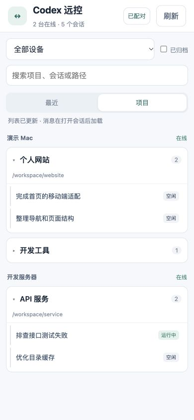
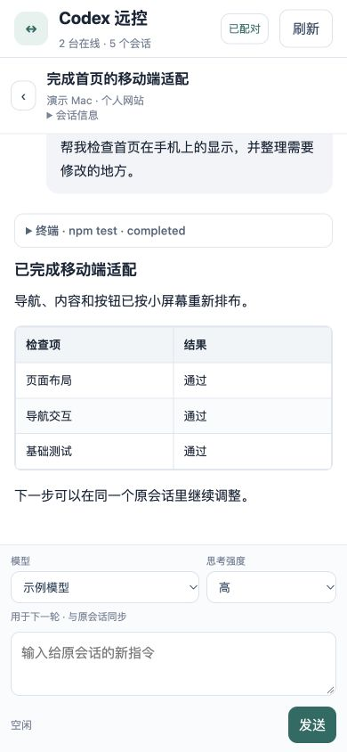
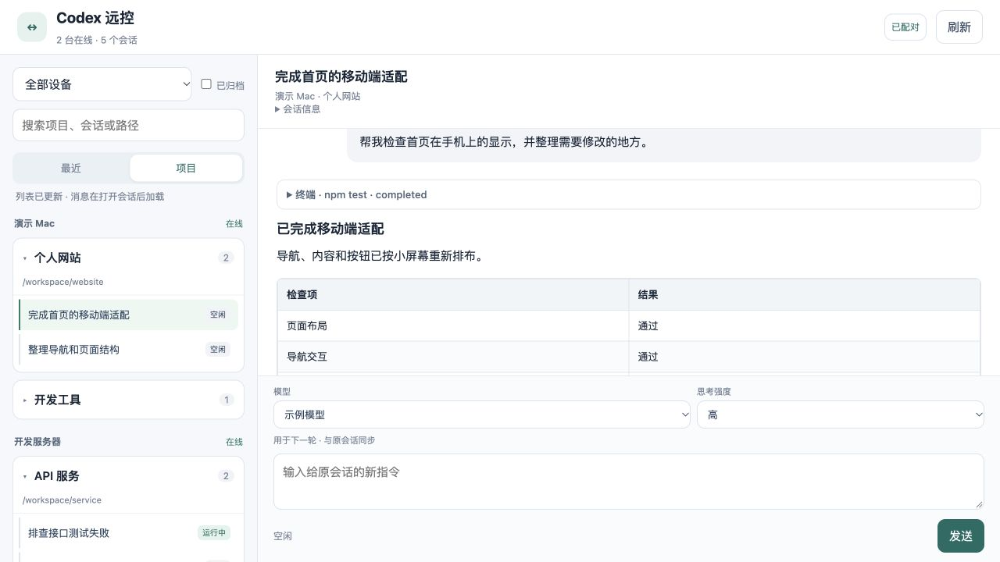

# Codex Browser Bridge

**用手机浏览器，继续电脑上的 Codex 会话。**

Self-hosted browser control for existing Codex desktop and SSH chats.

[](https://github.com/Sispheqgj/codex-browser-bridge/actions/workflows/ci.yml)
[](LICENSE)

<table>
  <tr>
    <td align="center"><br>按项目查找会话</td>
    <td align="center"><br>在原会话中继续工作</td>
  </tr>
</table>

<sub>截图使用只读演示数据，不含真实会话或账号信息。</sub>

## 功能

- **原会话接续**：查看回复、发送指令、补充当前任务、停止任务和处理常见审批。
- **本机与 SSH**：统一浏览 Mac 和已连接服务器上的项目、最近会话及归档历史。
- **模型设置**：从目标设备读取可用模型与思考强度，设置从下一轮生效。
- **手机阅读**：支持 Markdown、代码高亮、表格和公式，历史消息按需加载。
- **独立配对**：浏览器首次输入密钥后记住登录，手机上的 ChatGPT 账号保持不变。

> 实验性项目：目前面向 macOS，依赖 Codex 桌面的内部接口。其他机器上的兼容性仍需验证，详见[验证范围](docs/validation.md)。

## 快速开始

需要 **macOS、已登录的 Codex 桌面应用和 Node.js 24+**。手机远程访问还需要一个 HTTPS 入口。

**1. 下载并初始化**

```sh
git clone https://github.com/Sispheqgj/codex-browser-bridge.git
cd codex-browser-bridge
npm ci
npm run build
npm run init
```

**2. 配置电脑端连接**

按照[安装指南](docs/setup.md)填写 `~/.codex-browser-bridge/config.json`，将辅助服务加入 Codex 的 MCP 配置，并配置 HTTPS 入口。可以使用 Tailscale Funnel，也可以通过私有 tailnet 访问。

```sh
npm run doctor  # 检查先决条件
npm run mcp     # 查看需要添加的 MCP 配置
```

**3. 在手机上打开**

打开 `https://你的入口/original/index.html`，首次输入私有 `access-token` 文件中的配对密钥。选择设备、项目和会话，即可继续工作。

保持 Mac 和 Codex 运行、联网。密钥只供自己使用；Codex 登录凭据继续留在原设备上。

## 先看看界面

```sh
npm ci
npm run demo
```

打开终端显示的本地地址即可预览。演示使用虚构数据，不连接 Codex、不读取真实会话，所有写操作都会被拒绝。

<details>
<summary>查看桌面布局</summary>



</details>

## 项目结构

```text
src/        后端、桌面与 SSH 连接、MCP 入口
web/        浏览器界面、样式和 Markdown 渲染
tests/      自动化测试与测试数据
scripts/    构建、格式化和发布检查
examples/   配置示例与只读演示
docs/       配置指南、架构说明和截图
dist/       本地构建产物，不提交 Git
```

更多：[安装配置](docs/setup.md) · [开发指南](docs/development.md) · [工作原理](docs/architecture.md) · [同类项目](docs/related-work.md) · [安全说明](SECURITY.md)

[MIT License](LICENSE) · 独立开源项目，与 OpenAI 无隶属关系。
