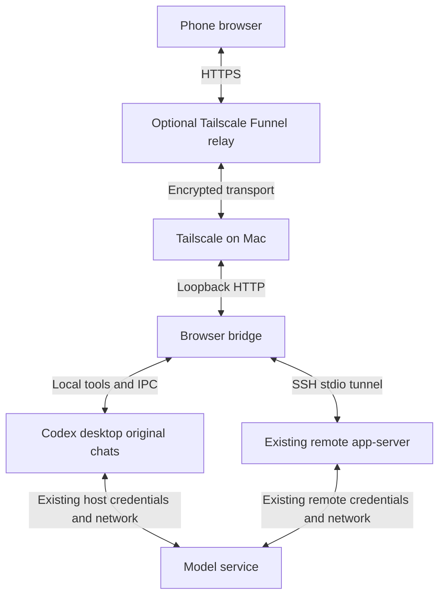

# Architecture

The browser sends prompts, controls and settings to a bounded HTTP API. The bridge validates its own pairing credential; ChatGPT authentication stays in the existing host configuration. This is remote access to the user's existing environment, not synchronization between two ChatGPT accounts.

`src/mcp/index.mjs` lets the Codex MCP manager own one bridge process. It advertises only a status tool; the web API has control capabilities. The owner lock and local health check prevent ordinary duplicate startup. They are lifecycle coordination, not an additional authorization mechanism.

`src/transports/desktop-tools.mjs` uses the desktop's local tool pipe for catalog/history and native message delivery. `src/transports/desktop-ipc.mjs` discovers the owning client and handles selected controls, settings and pending requests. Normal peer/process trust checks remain enabled. These are internal interfaces and require a compatible desktop version and launch arrangement.

Configured direct SSH connections run `codex app-server proxy --sock <existing socket>` on the remote host. The WebSocket client runs over the SSH process's stdin/stdout; it does not publish a remote WebSocket port. The original thread ID is checked after resume/read. No history fork or new task is created merely to display the existing thread.

The catalog discovers desktop hosts, paginates history and reads desktop project metadata. Explicit membership wins before a directory-prefix fallback. Cache files contain metadata, not full transcript exports. A limited number of host catalog refreshes run concurrently. Cached rows survive temporary host failures.

Opening a chat loads recent items only. Server events tell the browser to refresh the selected snapshot; a periodic fetch provides a fallback. This is eventual UI convergence with coalescing, not a distributed transaction or a guarantee of zero-latency token mirroring. Phone disconnects do not intentionally cancel submitted work. Uncertain sends are not automatically replayed.

Next-turn model settings are validated against the target catalog. A loaded desktop thread uses its owner; a configured remote uses its existing app-server; an unloaded local thread stores an explicit pending choice until the next message. The small local model-catalog reader does not resume or execute original chats.

The frontend renders Markdown with HTML disabled, sanitizes the result, renders math and code locally, and keeps remote file/image references as placeholders. Catalog metadata, drafts and UI preferences may persist in browser storage. Full local files and arbitrary desktop RPC methods are not exposed as browser endpoints.

Changing the phone's network changes the browser-to-bridge connection. Model requests continue through the existing execution host's network configuration. A host network/exit-node/proxy change can still change the model-facing exit; no claim is made about provider risk scoring.
